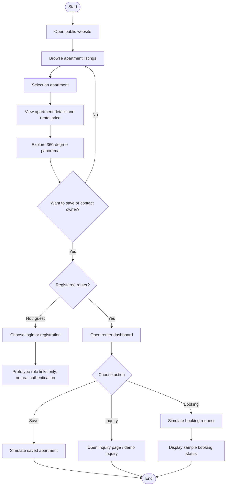
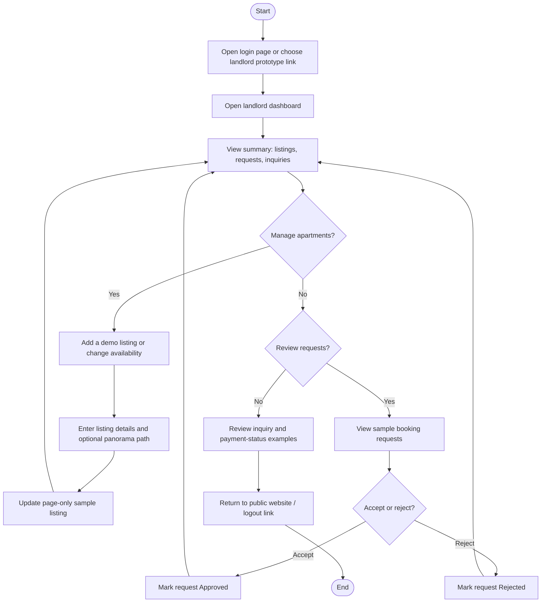
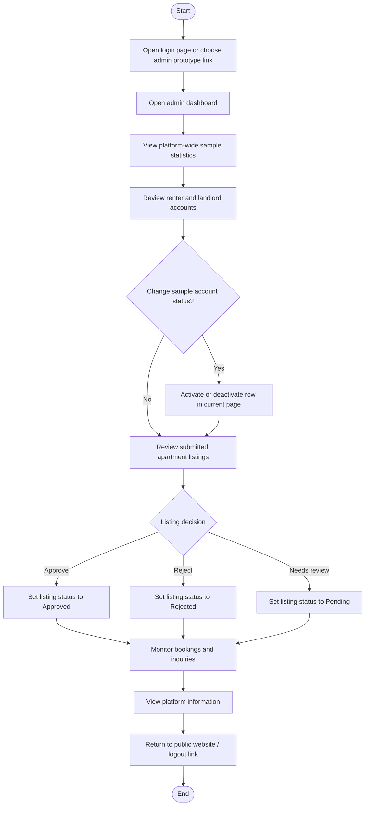
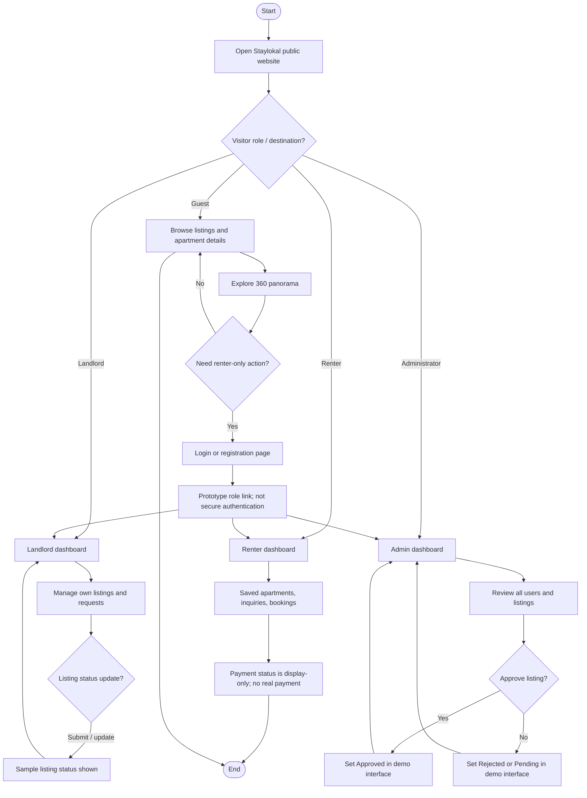

# Staylokal Rental Apartment Prototype — System Flowcharts

> **Prototype note:** These diagrams describe the intended front-end demonstration. Login/role selection, listing approval, inquiries, bookings, and payment statuses are not backed by a server or database. Do not use this prototype for real authentication or payment.

## 1. Guest and Renter Flow

## 2. Landlord Flow

## 3. Administrator Flow

## 4. Overall System Navigation

